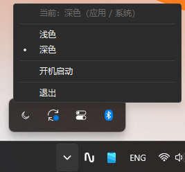

# TinyTheme

Windows 11 浅色 / 深色主题一键切换。单文件、无运行时依赖、免安装。

点一下托盘图标，系统深浅色立刻互换——不用再翻 设置 → 个性化 → 颜色。



## 安装

1. 访问 [Releases](https://github.com/Lonennn/TinyTheme/releases) 页，下载最新版本的压缩包并解压到任意目录（路径可含空格与中文）。
2. 双击 `TinyTheme.exe`，通知区域出现太阳或月亮图标。
3. 卸载：右键 → 退出，然后删除 exe。

适用于 Windows 10 1809 及以上与 Windows 11，x64。

## 使用

| 操作 | 结果 |
|---|---|
| 左键单击托盘图标 | 切换浅色 / 深色 |
| 右键单击托盘图标 | 打开菜单：状态摘要、浅色 / 深色、开机启动、退出 |
| 双击托盘图标 | 打开配置文件 |

图标即状态：太阳 = 当前浅色，月亮 = 当前深色，悬停可看到当前模式。

便携模式、配置文件、日志、卸载清理与已知限制：[使用指南](docs/usage.md)

## 从源码构建

需要 Visual Studio 2022（"使用 C++ 的桌面开发"）+ CMake 3.28+ + Ninja：

```powershell
.\tools\build.ps1 -Preset x64-release -Test
```

预设选择、静态分析、打包与发布核对：[构建文档](docs/engineering/06-build.md)

## 文档

- [使用指南](docs/usage.md)：便携模式、配置、日志、常见问题
- [开发文档索引](docs/README.md)：产品、架构、构建、测试、决策记录

## 许可证

[MIT](LICENSE)
